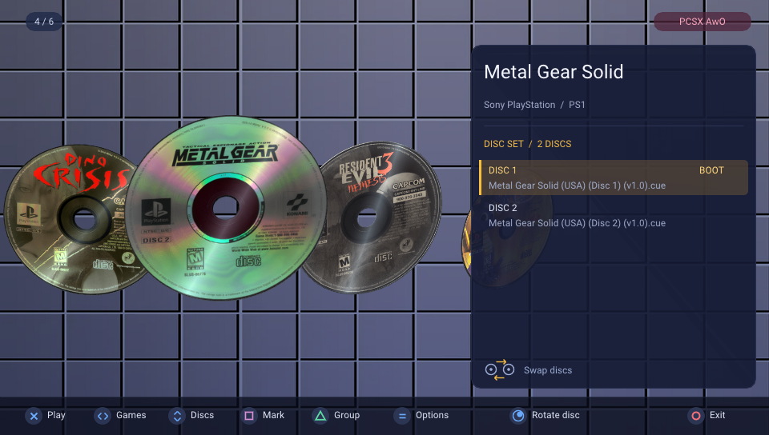

# PCSX AwO
</imd>
PCSX AwO (ARMed with Octane) is a fork of PCSX ReARMed specifically tailored for PSVita, featuring a ultra optimized new renderer derived from [Crash Team Racing: High Octane](https://github.com/Rinnegatamante/Crash-Team-Racing-High-Octane).

## Features

- Accurate ReARMed NEON software rasterizer with optional 2x internal resolution support.
- Highly performant hardware accelerated High Octane renderer with native Vita internal resolution and MSAA 4x.
- Support for games in .bin/.cue, .iso, .img, .chd, .pbp, .m3u and .exe format.
- Elegant UI with 3D disc covers art for game selection
- Multidisc games support.
- Experimental frame generation for games running at 25/30 FPS natively. (Only for High Octane renderer)
- Post-processing shader effects (CRT, Greyscale, Sepia, Negative, Sharp Bilinear, LCD 3x and more)
- Support to up to 4 controllers on PSTV or PSVita using MinivitaTV plugin.
- Turbo CD and CD read ahead features for faster loading times in games.
- Unstretched widescreen 16:9 aspect ratio. (Only for High Octane renderer)
- Support for custom bubbles generation.

## Paths

- Games go in ux0:data/pcsx-awo/roms
- Bios (optional) goes in ux0:/data/pcsx-awo/bios

## Special Controls

- Start + Select: Opens the Pause menu during emulation
- Top left/Top right on rearpad: L2/R2

## Changelog

### v.0.5.1
- Moved covers arts into a PSARC archive: installing the emulator will be significantly faster and it fixes stutters in the game selector when scrolling discs.
- Fixed L2 and R2 mapping being inverted.
- Added support for custom paths for games.
- Properly aligned footbar button hints in the game selector and pause menu.
- Made so that settings are saved on a per-game basis.
- Removed the vitaGL splashscreen at boot.
- Increased the memory pool available to vitaGL during execution.
- Added an hack that fixes sporadic GPU crashes with Ehrgeiz.
- Added a new option that allows to change the way memory cards are handled on each game.

## Credits

- Ari64 for the original PCSX DynaRec.
- Exophase for the ReARMed NEON renderer.
- notaz for PCSX ReARMed.
- Standard-Republic for the Livearea assets.
- Robin55, Circo, Community for the discs cover arts.
