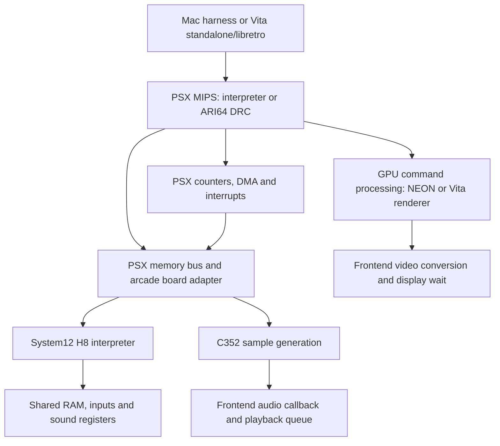

# Current PCSX arcade architecture and recommendation

Source review: 2026-10-05, following the System12 clock and performance
experiments recorded in [system12-performance.md](system12-performance.md).
This is an architecture proposal; no workers, affinity changes, scheduler
refactor or additional board ports are implemented by this document.

## Current execution path

The tested Vita package executes the emulation paths sequentially. Its main
MIPS DRC produces ARMv7 code. Vita3K adds an outer translation layer to run the
ARMv7 application on the ARM64 Mac; native Mac tests do not have that layer.
Consequently, native throughput is not a prediction of physical Vita throughput.
GPU SIMD and hardware graphics submission are distinct from a CPU worker.

The **H8** is the emulated Hitachi H8/3002 auxiliary CPU of System12, not a host
thread or another PSX CPU. It runs its own ROM at 16.9344 MHz, handles board I/O
and sound register accesses, and communicates with the MIPS through shared RAM.
`libpcsxcore/system12.c` owns its interpreter, shared backing, C352, EEPROM and
RTC. `system12_sync()` advances H8, then generates the C352 samples due for the
interval. The PSX bus exposes the mapped shared window; H8 bus callbacks handle
the different byte order.

H8 is not equivalent to the PSX SPU. The SPU is a sound synthesis chip;
System12's board audio chain is MIPS commands/shared RAM → H8 firmware → C352
sample generation. The existing SPU worker does not accelerate that chain.

## Existing optional workers

| Worker | Existing implementation | Control and limits |
| --- | --- | --- |
| GPU | `plugins/gpulib/gpu_async.c`: command queue, render thread, synchronization and teardown | `USE_ASYNC_GPU=1` at build time; `pcsx_rearmed_gpu_thread_rendering` at runtime. This is gpulib infrastructure, including the NEON path; support and correctness of each renderer require validation. |
| PSX SPU | `plugins/dfsound/spu.c`: channel work queue and completion synchronization | `USE_ASYNC_SPU=1` and `pcsx_rearmed_spu_thread`. It does not execute System12 H8 or C352 audio. |
| CD read-ahead | `libpcsxcore/cdrom-async.c`: sector cache and prefetch thread | `USE_ASYNC_CDROM=1`, with frontend read-ahead configuration. It does not cover the arcade ATA/NCR adapters. |
| ARI64 compiler | `libpcsxcore/new_dynarec/emu_if.c`: background block compilation | `NDRC_THREAD=1`; the Vita platform sets it to zero with the source comment `can't write to tc from thread`. This parallelizes compilation, not MIPS instruction execution. |

`frontend/pcsxr-threads.c` supplies common thread creation. Its explicit
core-selection logic is for 3DS; there is no validated Vita 0/1/2 allocation in
this work. `Makefile.vita` disables GPU, SPU and CD async, and the standalone
option table also disables GPU/SPU threading. The tested VPK uses those choices.
SDL playback has a queue; actual backend threads and affinity have not been
measured. The profiler currently rejects async GPU/SPU because its state and
nested scopes assume synchronous execution.

## Board and frontend coverage

This matrix describes reachable integration, not complete game compatibility.
The full target remains the [491 MAME registrations in ten driver
families](mame-psx-systems.md). Optional adapters require their build flags.

| Family | Mac integration / main components | Libretro integration and remaining boundary |
| --- | --- | --- |
| Retail PSX | Existing console CPU, GPU, SPU and CD core; native EXE smoke | Existing console path; full pinned retail machine validation remains open. |
| Sony ZN, including Taito FX1 | `systemzn.c` / `systemtaito.c`; common ZN security/SIO/EEPROM, Capcom Z80/QSound and FX1 Z80/YM2610 | No arcade profile loader for these adapters. Other ZN daughterboards and authentic games remain open. |
| G-Net | `systemgnet.c`; common ZN, Zoom MN10200/TMS57002/ZSG2, RF5C296 and CHD-backed ATA card | Optional profile loader exists. Synthetic MIPS storage execution passes interpreter/DRC; authentic boot, title I/O, Zoom audio mixing and persistent frontend state remain open. |
| Konami GV | `systemgv.c`; NCR/CD/CHD, EEPROM, DUART, IRQ10 and DMA5 | No arcade profile loader. Authentic BIOS/CD boot and special I/O remain open. |
| Konami GQ | Standalone `arcade/konamigq.cpp`; sound CPU/DSP/PCM and NCR HDD components | No adapter connecting the board to the PSX execution/frontend path. |
| System 573 | Security, flash and shared media foundations | No native arcade board adapter or frontend path. |
| Twinkle | Standalone `arcade/twinkle_board.cpp`; MC68000, RF5C400, wave RAM and mailbox | No native PSX frontend path; ATA/media and main-board integration remain open. |
| System10 | `system10.c`; MEM(M)/(N), crypto/banks, NAND DMA and I/O | No profile loader; authentic games and extension boards remain open. |
| System11 | `system11.c`; C76/M37710, shared RAM, C352, keycus and EEPROM | No profile loader; authentic programs and variant validation remain open. |
| System12 | `system12.c`; H8, C352, shared RAM, EEPROM, RTC, banks and ROM DMA | Soul Calibur Asia C has guarded Mac/Vita3K DRC/NEON replays. Other variants, timing equivalence, physical Vita and vitaGL remain open. |

The Mac `HarnessBoard` table already groups load/unload/sync/input/report and
some persistence/audio functions. Libretro has separate System12 and G-Net
load/reset/unload flows. The memory bus dispatches to individual active adapters;
device composition alone does not make an adapter reachable from a frontend.

## Scheduling and clock gaps

Mac calls the selected adapter after every `ExecuteBlock`. Libretro executes
the core until its frame boundary; System12 catches up on the two vblank edges,
and G-Net additionally catches up after `Execute` and at mapped accesses.
System12 ignores a sync delta below 256 main cycles and retains it for a later
call. This leaves different device slice sizes and shared-memory observation
points between hosts. System12 shared reads/writes currently do not themselves
force H8 synchronization.

H8 executes its entire slice before C352 generates the interval's samples.
Register writes during that slice therefore precede all samples generated for
it. Coherent aggregate cycle/sample totals do not prove correct write/sample
ordering. A scheduler change must establish the intended causal order before
changing these boundaries; blindly adding synchronization to recursive bus
callbacks is not sufficient.

The source timing layer in `psxcommon.c` selects the PSX cycle frequency during
init/reset. It preserves independent device clocks and fractional conversion;
the [timing document](arcade-source-timing.md) explains the source input-clock
conversion and build options. System12 retains its separate source-timing
switch. Unsupported native families have no source-clock adapter yet.

There is also a PSX SPU clock contract to resolve: dfSound derives sample work
from supplied cycle differences in units of 768, and contains fixed 44.1 kHz
buffer/scheduling assumptions. A different main-CPU clock cannot automatically
be used as the SPU oscillator. Future integration needs explicit timestamp
conversion and output-rate handling, including direct DRC plugin calls, IRQ
deadlines, reset/state epochs, XA and CDDA. This is separate from System12's
88.2 kHz C352 callback, whose aggregate sample count was measured.

Frontend pacing is another clock: Vita video conversion and its display vblank
wait, plus audio queue backpressure, block the emulation producer. The headless
Mac path does not perform the same presentation work. Neither should determine
the emulated oscillator rates.

## Comparison with the pinned MAME execution model

The relevant local sources were checked at
`deb2f54fe7300e7a192690318beb860159bfd52a`, with no working-tree differences in
`namcos12.cpp`, `h8.cpp`, `h83002.cpp`, `h8_timer16.cpp`, `c352.cpp`,
`diexec.cpp` or `schedule.cpp`.
This is a source comparison, not a measured MAME scheduler trace.

| Boundary | Pinned MAME behavior | Current port / implication |
| --- | --- | --- |
| CPU scheduling | `src/emu/schedule.cpp::rebuild_execute_list` defaults to a maximum 1/60 s quantum; `timeslice` caps the target at the next global timer and advances each CPU's local time. No explicit maximum/perfect-quantum override was found in the System12 driver or reviewed PSX/H8 configuration. | The default quantum does not establish the actual CPU slice length. Neither Mac block boundaries nor two libretro vblank syncs can be justified as equivalent solely from this value. Measure actual slice targets before choosing a common policy. |
| Shared RAM | `namcos12.cpp::sharedram_r/w` directly access shared words; the handlers contain no explicit scheduler synchronization. | Both ports already have source-derived lane/endian coverage. Adding a catch-up before every shared access would introduce a different scheduling policy; it needs an event-order justification, not just a map test. |
| H8 internal events | `h83002.cpp::internal_update` selects the earliest ADC, SCI, timer and watchdog event. `h8.cpp::execute_run` uses that boundary, partial execution states and carried cycle debt. | Our interpreter calls `tick` between full execution states, including prefix states. Matching aggregate H8 cycles does not validate where a device event falls relative to an instruction's bus accesses. Deadline and partial-state semantics are a separate fidelity requirement. |
| Timer state | `h8_timer16.cpp` advances counters arithmetically, recomputes IRQ deadlines and catches up on register accesses. It explicitly accounts for polling status with interrupts disabled. | The current per-tick loop is a performance candidate, but skipping updates simply because no IRQ is enabled would lose observable flags/counter state. Deadline conversion must retain lazy-read/write catch-up as well as IRQ timing. |
| C352 register access | `src/devices/sound/c352.cpp::read/write` calls `m_stream->update()` before inspecting or changing voice registers. | Our `c352_read/write` has no timestamp or stream catch-up; the board generates samples after the whole H8 slice. The source gives a concrete requirement: render prior samples using prior register state before applying each timed access. Reads matter too, because they observe sample-dependent flags. |
| Vblank | `namcos12.cpp::namcos12_sub_irq` drives IRQ1, ADTRG and the port-B vblank bit from the screen callback. | The port preserves these signals and catches up before delivering its edge. Edge phase/order still needs a common trace across frontends and MAME. |

In particular, audio synchronization cannot be repaired by running all H8 work
first and merely splitting the subsequent C352 output into smaller buffers.
The new register state would still be applied to samples preceding the write.
The board needs a timestamped register-access boundary, with an audio cursor and
fractional sample phase. Its time source must describe the access within H8
execution, not only the main CPU's end-of-slice counter. The current H8 callback
API carries addresses/data but no explicit access timestamp; adding such a
contract is future design work, including instruction bus-cycle accounting.

MAME makes that access time explicit through its execution context:
`schedule.cpp::time` uses the currently executing CPU's `local_time`, and
`diexec.cpp::local_time` includes the cycles consumed within its current slice.
The H8 read/write helpers charge bus cycles before calling the memory handler.
In our interpreter, the public `H8Status.cycles` advances at `tick`; querying
that counter during a bus callback would omit costs already charged inside the
current execution state. A timestamp contract must cover that difference too.

A scheduler proposal must specify the same-time ordering of CPU advancement,
device deadlines, register accesses, DMA and external edges; carry overshoot
without advancing a device twice; and separate emulated audio generation from
frontend playback backpressure. A finer interval alone is not evidence of better
fidelity. First compare timed shared-mailbox exchanges, C352 register/state and
sample boundaries, H8 IRQ/ADC edges and PSX DMA/interrupt traces. Existing boot
state samples and final framebuffer hashes do not cover those temporal claims.

## Recommendation and review gates

Keep one causal board timeline for the current study. Before considering host
parallelism, define common synchronization points for both frontends: shared
memory, MMIO, DMA and IRQ edges, with device deadlines ordered and fractional
clock remainders preserved. Timestamp sound-register accesses so audio samples
can be generated in their correct interval. Keep reset epochs and whole
instruction overshoot explicit rather than equating instruction count with
cycle count.

A future common board interface can build on `HarnessBoard`: profile selection
before CPU/GPU allocation; bus and DMA routing; reset/unload; input; ordered
advance/deadlines; audio delivery; persistence; and declared state support.
Frontend code should own display/audio queues, while the board owns emulated
time and device state. This is a proposed contract, not an implemented refactor.

For System12, the measured priorities are H8 interpreter/peripheral costs,
display/audio pacing, and Mac/Vita scheduling equivalence. The pending-IRQ
optimization preserves the tested replay and improves the paired Vita3K run
from 16.60 to 32.58 emulated fps. H8 remains 47.5% of post-change diagnostic
elapsed time; GPU list time is an estimated 11.5%. Existing GPU async is therefore
a later candidate with limited scope, not evidence that three cores will reach
60 fps. H8 parallelism would require a separate shared-memory/IRQ design.

Review evidence must distinguish component fixtures, executed synthetic PSX
guests, authentic game replays, cross-frontend event equivalence and physical
hardware validation. A parsed media profile or one successful game cannot
complete a family. For each board variant, retain interpreter/DRC bus and DMA
checks, media/persistence checks, controls, timed IRQ/audio traces and authentic
game evidence against the pinned MAME baseline. Do not report speculative
engineering estimates as measured completion percentages.

## H8/C352 worker and H8 DRC candidates

Treating H8/C352 as the board's audio/I/O subsystem makes a worker analogous to
the existing SPU worker a valid candidate. It would be a new worker using common
infrastructure, not an option that redirects H8 into dfSound's worker today.
The two candidates solve different problems and can eventually be combined:

| Candidate | Purpose | Required boundary / unresolved cost |
| --- | --- | --- |
| H8/C352 worker | Overlap auxiliary CPU/audio work with independent MIPS/GPU/frontend work. | One owner for H8/C352 state; timestamped external events, bounded work/PCM queues, barriers for shared-memory visibility and deterministic reset/teardown. Frequent mailbox accesses may eliminate much of the overlap. |
| H8 DRC | Reduce interpreter dispatch and instruction execution cost while keeping the initial execution synchronous. | H8 decode/flags/register semantics, cycle and event exits, observable bus accesses, mutable-code invalidation and interpreter fallback. Peripheral/bus costs remain; the measured H8 scope does not isolate dispatch cost. |

The SPU precedent is concrete: `queue_channel_work` in `plugins/dfsound/spu.c`
packages channel parameters and advances control state on the producer;
`do_channel_work` processes queued audio work; `sync_worker_thread` waits/reaps
results and restores state when required. It uses a bounded four-item queue and
retains IRQ/control work in the synchronous path. The thread/queue/completion
pattern is reusable, but its channel snapshots are not a representation of an
H8 CPU executing arbitrary firmware with shared-memory and I/O effects.

For an H8/C352 worker proposal, the worker would advance to an agreed emulated
deadline and deliver ordered memory/event effects and PCM. The main CPU must
observe H8 writes only at their defined time and wait when it needs an
unpublished result. Main-to-H8 shared writes, IRQ/ADTRG, inputs and serial events
also need a defined ordering before the worker passes their timestamp. Both
CPUs cannot access the existing mutable `board.shared` concurrently without
that contract. C352 access/sample ordering belongs to the same owner/timeline;
putting only H8 on another thread leaves its C352 callbacks racing the generator.
Do not assume frame-sized jobs are safe just because audio is consumed in
buffers. Host audio waits should not hold board-state locks needed by the main
CPU, and reset/unload must drain or cancel old-epoch work before freeing state.

An H8 DRC is a separate ISA backend; the existing MIPS ARI64 compiler cannot
compile H8 instructions unchanged. It may offer host-code emission techniques,
but H8 state, flags and timing still need their own implementation. Vita requires
ARMv7 output and code-cache visibility support. A native M1 DRC comparison would
require ARM64 output or use the H8 interpreter as its control; Vita3K executes
the ARMv7 package through its outer translator. These are different validation
paths, not one interchangeable cache of host instructions.

Recommendation: first obtain H8 dispatch/peripheral/bus cost and timed mailbox
traffic, then choose the initial implementation. If instruction execution
dominates, a synchronous H8 DRC directly reduces work without adding ownership
changes. If independent auxiliary work has long intervals between barriers, the
worker can overlap it. If timers or bus handling dominate, improve those paths
before expecting either candidate to remove their cost. Keep a synchronous
reference for deterministic event/audio comparison. No worker or DRC is
implemented by this proposal, and neither has a measured speedup yet.
